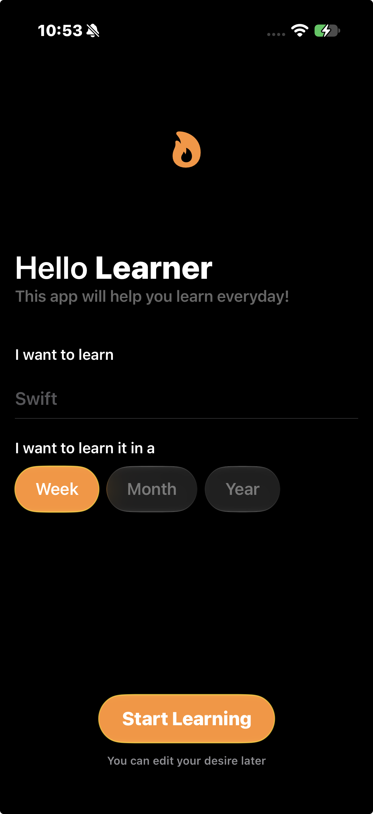
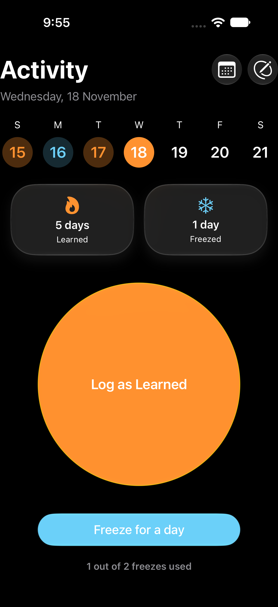
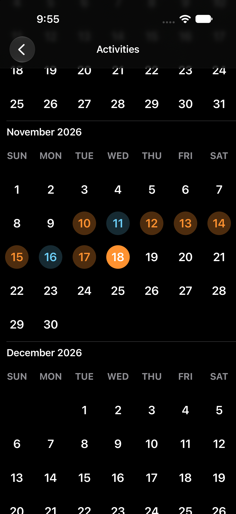

# Learning Journey 

**Learning Journey App** is an iOS app designed to help users build consistent learning habits and stay motivated. By setting personal learning goals, tracking daily progress, and maintaining learning streaks, users can develop a learning routine and work toward their goals.

## ✨ Features

### 🎯 Learning Goals
- Create a personal learning goal.
- Choose a goal duration: **Week, Month, or Year**.

### 🔥  Streaks
- Track consecutive days of progress.
- Use freeze days to maintain consistency when taking a break.

### ❄️ Freeze Days
- Record a freeze day when unable to learn.
- Track the number of freezes used.
- Freeze allowances depend on the selected goal duration.

### 📅 Activity Calendar
- View the current week directly from the main screen.
- Explore learning history through a yearly calendar.
- Identify learned days and freeze days using visual indicators.

### 🌗 Light & Dark Mode
- Supports both Light and Dark Mode.

## 🛠️ Technologies Used

- **Swift** — Programming language
- **SwiftUI** — User interface development
- **MVVM** — Architectural pattern
- **HorizonCalendar** — Yearly calendar interface
- **Xcode** — Development environment

## 📱 How It Works

1. Enter a learning goal and select its duration.
2. Start your learning journey.
3. Log your daily activity as Learned or Freeze.
4. Monitor your streak and remaining freeze days.
5. Open the yearly calendar to review your learning history.

## 📸 Screenshots

  
  
  

## 🚀 Getting Started

1. Clone the repository
2. Open `Learning_CH2.xcodeproj` in Xcode.
3. Allow Xcode to resolve the Swift package dependencies.
4. Select an iOS simulator or a compatible device.
5. Build and run the project.

## developer:
-**Wateen Alrumayh**

